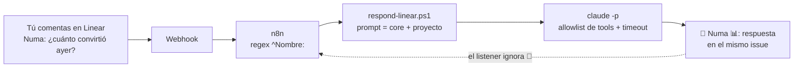

# agent-team-template

Template para correr un **equipo de agentes de Claude Code** que opera un producto de software: analizan datos, proponen mejoras, diseñan mockups, escriben código (vía PR), hacen QA, publican contenido y hasta **mejoran a los otros agentes**. Siempre con una persona en el medio de cada decisión que importa.

No es una app ni un framework: es un repo de **configuración versionada** (system prompts, skills, wrappers de PowerShell, configs de MCP y workflows de n8n) que Claude Code consume en dos entornos:

- **Server headless** (Windows): `claude -p` disparado por crons y webhooks de **n8n**.
- **Claude Code / Cowork desktop**: uso interactivo y revisión humana.

El repo trae un proyecto de ejemplo, **Acme** (`projects/acme`, team de Linear `ACM`), que puedes copiar como punto de partida para tu propio producto.

---

## Cómo funciona en 1 minuto

- Hay **9 agentes** con identidad propia (nombre, emoji, rol, modelo, herramientas). Su identidad es código: vive en [`scripts/agents.ps1`](scripts/agents.ps1).
- Los llamas **comentando en un issue de Linear** con `Nombre: pedido`:
  ```
  Numa: ¿cuánto convirtió ayer por canal?
  ```
  Un workflow de n8n recibe el webhook, detecta el nombre y corre el agente con `claude -p`. El agente responde en el mismo issue con un comentario firmado `🤖 Numa 📊: ...`.
- Algunos agentes **corren solos por cron** (skills programadas en n8n): reportes diarios, revisiones semanales de SEO/AEO, escaneo de deuda técnica, priorización del roadmap.
- Cada skill declara un **nivel HITL** (human-in-the-loop): **1** = lee y reporta, **2** = propone y espera tu OK, **3** = ejecuta con rollback (reservado, no se usa todavía).
- Los cambios de código **siempre son PRs**: Cody abre el PR en el repo del producto; tú lo revisas y lo mergeas.
- **Alfred** es un meta-agente: cuando un agente actúa mal, diagnostica la causa raíz y abre un PR contra **este** repo (prompts, wrappers, skills, docs).



👉 Manual de uso del día a día: [`docs/como-usar-los-agentes.md`](docs/como-usar-los-agentes.md).
👉 **Por qué está armado así** (la forma de trabajar y las lecciones detrás de cada regla): [`docs/como-trabajo.md`](docs/como-trabajo.md).

## Qué necesitas

| Pieza | Para qué | ¿Obligatoria? |
|---|---|---|
| **Claude Code** con suscripción (login OAuth) o API key | Es el runtime de todos los agentes | Sí |
| **Linear** (+ API key) | Donde llamas a los agentes y donde dejan su trabajo | Sí, tal como viene ([alternativas](docs/alternativas.md)) |
| **GitHub** + `gh` CLI | Cody y Alfred abren PRs | Para Cody y Alfred |
| **n8n** (self-hosted) | Crons y el listener de comentarios | Para el modo headless ([alternativas](docs/alternativas.md)) |
| Una máquina **Windows** siempre prendida | Corre n8n y los wrappers de PowerShell | Para el modo headless (portable a Linux/macOS con `run-skill.sh` como referencia) |
| Supabase, GA4, Search Console, Stripe… | Fuentes de datos de Numa y Greta, vía MCP | Opcionales: activas solo las que uses |

¿Solo quieres probar el método? Empieza sin server: completa el contexto de tu proyecto y usa las skills desde Claude Code en tu máquina. El camino paso a paso está en [`docs/como-trabajo.md`](docs/como-trabajo.md#empezar-sin-montar-todo).

## El equipo

| Agente | Rol | Qué hace |
|---|---|---|
| **Capi** 🫒 | Project Lead / routing | Responde, rutea al agente correcto, crea issues para trackear trabajo y prioriza el roadmap. |
| **Numa** 📊 | Data | Funnel, conversión, revenue y anomalías (Supabase, GA4, Stripe — solo lectura). |
| **Greta** 📈 | Growth | Ads, SEO, AEO, email y copy customer-facing. Revisiones semanales por cron. |
| **Pico** 🎯 | Product | Convierte insights en propuestas (`[Proposal]`) y escanea ideas de producto. |
| **Cody** 💻 | Code | Lee y escribe el repo del producto, corre el gating local y **abre PRs**. Nunca mergea. |
| **Qualy** 🧪 | QA | Tests, smoke de producción no destructivo y review visual de previews. Reporta PASS/FAIL. |
| **Daly** 🎨 | UX/UI | Escribe **mockups HTML reales** + un brief para Cody en `design/`. |
| **Leda** 📖 | Contenido | Mejora drafts del blog, genera la imagen, agenda y publica con ventana de cancelación. |
| **Alfred** 🎩 | Meta-agente | Mejora a los otros agentes con PRs a este repo. |

---

## Estructura del repo

```
agent-team-template/
├── .claude-plugin/marketplace.json  # registro de los plugins propios
├── plugins/
│   ├── team-shared/    # brand voice, glossary, personas, design system + skills de contenido
│   ├── team-growth/    # skills de growth/SEO/AEO/funnel + configs de MCP
│   ├── team-data/      # queries de solo lectura
│   └── team-pm/        # insight → propuesta → roadmap
├── projects/
│   └── acme/           # bundle de configuración del proyecto de ejemplo
│       ├── project.json         # metadatos, IDs, paths, agentes habilitados
│       ├── *.md                 # contexto: brand-bible, glossary, data-model, icp, product-catalog, roadmap
│       ├── agent-overrides/     # rol de cada agente EN este proyecto
│       └── skills/              # skills propias del proyecto
├── scripts/            # runtime headless (PowerShell)
│   ├── agents.ps1      # ⭐ registry de agentes (identidad, modelo, tools, timeout)
│   ├── project.ps1     # resolución de proyecto, env y prompt
│   ├── run-skill.ps1   # wrapper de crons: corre una skill vía `claude -p`
│   ├── respond-linear.ps1  # listener: responde comentarios `Nombre:` en Linear
│   ├── run-*.ps1       # wrappers dedicados (Alfred, roadmap de Capi, scan de Cody, SEO/AEO de Greta, Qualy…)
│   └── mcp-*/          # MCPs propios (Core Web Vitals, Search Console)
├── automation/n8n/     # ⭐ workflows de n8n (crons + listener), fuente versionada
├── memory/             # knowledge base que carga cada agente al arrancar
├── design/             # output de Daly (mockups + briefs) — SÍ se versiona
├── docs/               # arquitectura, setup, manual de uso
├── evals/              # casos de prueba por skill
├── queue/              # cola HITL compartida — NO se versiona
└── audit/              # log de corridas — NO se versiona
```

---

## Quickstart

1. **Clona** el repo en tu máquina (y, más adelante, en el server).
2. **Copia el proyecto de ejemplo**: `projects/acme` → `projects/<tu-slug>`.
3. **Completa `project.json`**: nombre, `ownerName`, team de Linear (`teamKey` + `teamId`), `productRepoPath`, `productRepoUrl`, `productUrl`, stack, convención de idioma, foco estratégico y agentes habilitados. Todo lo marcado con `TODO(acme):` o `{{PLACEHOLDER}}` lo completas tú.
4. **Escribe el contexto** del proyecto (`brand-bible.md`, `glossary.md`, `data-model.md`, `icp.md`, `product-catalog.md`) y ajusta los `agent-overrides/`. Atajo: pídele a Claude que los redacte a partir del repo de tu producto y revísalos.
5. **Secretos**: copia `.env.example` → `.env.server` (core) y `.env.acme.example` → `.env.<tu-slug>` (por proyecto). Ambos quedan fuera de git.
6. **Instala los plugins** en Claude Code / Cowork: *Settings → Plugins → Add marketplace → Local folder* → apunta a este repo → instala `team-shared`, `team-growth`, `team-data` y `team-pm`.
7. **Server headless**: sigue [`docs/server-setup.md`](docs/server-setup.md) (Node + Claude Code CLI, keys, smoke tests).
8. **Importa los workflows de n8n** desde `automation/n8n/` (inactivos), pruébalos con *Execute Workflow* y recién después actívalos.

Checklist completo para sumar un proyecto: [`docs/add-a-new-project.md`](docs/add-a-new-project.md).

---

## Principios de diseño

- **Identidad como código.** Nombre, emoji, rol, modelo, herramientas y timeout de cada agente viven en `scripts/agents.ps1`. Cambiar cómo actúa un agente es un diff revisable, no un ajuste perdido en una UI.
- **Core vs. overrides por proyecto.** Un solo equipo sirve a varios proyectos. Lo que mejora *cómo trabaja un agente* va al core (`agents.ps1`, wrappers); lo que cambia *el dominio* (tablas, tono, stack, comandos de gating) va a `projects/<slug>/`. Mejoras una vez y impacta en todos los proyectos.
- **Human-in-the-loop siempre.** Los agentes proponen; las personas deciden. Nada se mergea, se publica ni se ejecuta en producción sin un gate humano explícito (review de PR, aprobación del issue, ventana de cancelación).
- **Cambios de código solo por PR.** Cody y Alfred abren PRs; nunca mergean.
- **Firmas anti-loop.** Los agentes comentan con la API key de una persona, así que cada respuesta arranca con `🤖 <Nombre> <Emoji>:` y el listener ignora todo comentario que empiece con `🤖`.
- **Guard de runaway por tiempo, no por presupuesto.** Con una suscripción, el costo no limita; el riesgo real es un loop colgado. Cada agente declara `TimeoutMinutes` y un watchdog mata el árbol de procesos al vencer. `--max-budget-usd` queda como respaldo.
- **Mínimo privilegio en headless.** `--strict-mcp-config`, `--permission-mode dontAsk` y una allowlist de tools corta por wrapper. Los MCP de datos corren en `--read-only`.
- **Cero secretos en el repo.** Los `.mcp.json` usan `${VARIABLE}`; los valores viven en `.env.server` / `.env.<slug>`, que están en `.gitignore`.

---

## Seguridad

- **Nunca** commitees secretos: van en `.env.server` / `.env.<slug>`. El `.gitignore` cubre `.env*`, `secrets/`, `*.pem`, `*.key` y service accounts.
- **Nunca** pongas PII en el repo, en `queue/` ni en Linear: los agentes trabajan con agregados.
- Los MCP de base de datos van en modo **read-only**; las skills de data nunca escriben en producción.
- Si se filtra una key, **rótala** (Anthropic, GitHub, Linear, Supabase, Stripe, etc.).
- No hay skills de nivel 3 (ejecución autónoma): requerirían auditoría completa + rollback.
- Revisa la allowlist de tools de cada wrapper antes de habilitar un agente nuevo: es la principal barrera entre un prompt y tu infraestructura. Los agentes que leen texto de terceros (issues, web, logs) están expuestos a prompt injection; por eso ninguno puede mergear, publicar sin ventana ni escribir en producción.

---

## Adáptalo

- **Sin n8n o sin Linear**: n8n solo dispara scripts (se reemplaza con el Programador de tareas, cron o GitHub Actions); Linear es el tablero y se porta a GitHub Issues, Jira, Notion o Slack manteniendo el mismo patrón. Guía completa, con ejemplos y checklist: [`docs/alternativas.md`](docs/alternativas.md).
- **Otro sistema operativo**: el runtime vivo es PowerShell sobre Windows; `scripts/run-skill.sh` queda como referencia para Linux/macOS.
- **Menos agentes**: deshabilítalos en `project.json` (`"enabled": false`). Empieza con Capi + Numa + Cody y suma el resto.
- **Agentes nuevos**: agrega una entrada en `scripts/agents.ps1`, su nombre a la regex del listener y, si corre por cron, una skill + un workflow basado en `automation/n8n/_template-skill-cron.json`.
- **Otras fuentes de datos**: cambia los MCP del `.mcp.json` al que apunta `project.json → mcpConfig` (en `plugins/team-growth/` o uno propio en `projects/<slug>/`) y describe tus tablas en `data-model.md`.

---

## Documentación

Índice completo en [`docs/README.md`](docs/README.md).

---

## Créditos y licencia

Creado por Eliana Bracciaforte a partir del equipo de agentes con el que opera sus propios productos. Publicado bajo licencia [MIT](LICENSE).
