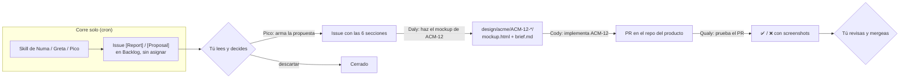

# Cómo se trabaja con este equipo (y por qué está armado así)

El resto de la documentación explica **qué** hace cada pieza. Este documento explica **por qué**: la forma de trabajar detrás del repo y las lecciones que dieron forma a cada regla. Si vas a adaptar el template, esto es lo que conviene no perder.

---

## La idea central

Los agentes no reemplazan decisiones: **reemplazan el trabajo que hay entre decisión y decisión**. Leer datos, armar un reporte, redactar una propuesta, escribir el código, probarlo, dejar el mockup listo. La persona decide qué entra al producto; los agentes hacen que decidir sea rápido porque cuando llega el momento, el trabajo ya está hecho y revisable.

Por eso todo pasa por **Linear**: es el lugar donde ya se decide. Un agente no tiene una interfaz propia; tiene un issue donde comenta.

## Un ciclo típico

1. **Lunes temprano** corren los crons: Numa revisa el funnel, Greta la semana de SEO/AEO, Pico escanea ideas y deuda técnica. Cada uno deja un issue `[Report]` o `[Proposal]` en *Backlog*, **sin asignar y sin prioridad**. El board se llena de material, no de compromisos.
2. **Tú lees** y promueves lo que vale la pena. Lo que no, lo cierras. Nada avanza solo.
3. Cuando algo merece construirse, **llamas al siguiente agente comentando en el mismo issue**: `Daly: haz el mockup de ACM-12`, `Cody: implementa ACM-12`, `Qualy: prueba el PR`. Cada uno lee el hilo completo, así que el contexto viaja con el issue.
4. **Tú mergeas.** Ningún agente puede hacerlo.
5. Si un agente se equivocó de una forma que se va a repetir, lo marcas y **Alfred** abre un PR contra este repo para que no vuelva a pasar.

El paso 5 es el que convierte un conjunto de prompts en un sistema que mejora: los errores no se corrigen en la conversación (donde se olvidan), se corrigen en el código de los agentes (donde quedan).

## Lecciones detrás de las reglas

### Los agentes proponen, las personas deciden
Cada skill declara un nivel HITL. Nivel 1 solo lee y reporta; nivel 2 propone y espera un OK explícito; nivel 3 (ejecución autónoma con rollback) existe en el diseño pero **no se usa**. No es desconfianza en el modelo: es que un error de un agente en producción cuesta mucho más que el minuto que lleva aprobar.

### Los issues nacen en Backlog, sin asignar y sin prioridad
Un agente que asigna o prioriza está decidiendo qué trabaja el equipo. Esa convención (label `agent-proposal`, estado `Backlog`, título `[Proposal] ...`, cuerpo con 6 secciones fijas) hace que todo lo generado por agentes sea fácil de filtrar, de revisar en bloque y de descartar sin culpa.

### La firma anti-loop no es decorativa
Los agentes comentan en Linear con la API key de una persona. Sin una marca, el listener vería su propio comentario como un pedido nuevo y el agente se respondería a sí mismo. Por eso cada respuesta arranca **exactamente** con `🤖 <Nombre> <Emoji>:` y el listener ignora todo lo que empiece con `🤖`. "Exactamente" importa: un `**` de markdown o un paréntesis alcanzan para romperlo.

### Cody es un agente ciego
Typecheck, lint y tests pasan aunque un botón quede invisible o un ícono desalineado: el agente no ve lo que renderiza. De ahí salen tres reglas: **reusar antes de crear** (buscar el componente que ya existe en vez de reinventarlo), **usar solo los tokens del design system** (nunca un hex suelto) y **pedir review visual** en el PR. Qualy, con un browser real, es el ojo que falta; Daly deja el mockup contra el que se compara.

### El límite es de tiempo, no de plata
Corriendo contra una suscripción, el costo por corrida no es el riesgo real; el riesgo es un loop colgado que ocupa la máquina toda la noche. Cada agente declara `TimeoutMinutes` y un watchdog mata el árbol de procesos (incluidos los servidores MCP) al vencer. El presupuesto en USD queda solo como respaldo.

### Mínimo privilegio por wrapper
En modo headless no hay nadie para aprobar un permiso, así que cada wrapper pasa una **allowlist corta de tools**, configuración de MCP estricta y bases de datos en solo lectura. Los agentes leen texto de terceros (issues, páginas web, logs), lo que los expone a prompt injection: la defensa no es el prompt, es que no tengan las herramientas para hacer daño.

### Core vs. proyecto: una regla para saber dónde va cada cambio
Si el cambio mejora **cómo actúa un agente** en general (su método, sus hard stops), va al core (`scripts/agents.ps1`) y beneficia a todos los proyectos. Si cambia **el dominio** (tablas, tono, comandos de test, archivos que no se tocan), va al override del proyecto. Esta regla es la que permite que un mismo equipo opere varios productos sin que el contexto de uno contamine al otro.

### El contexto es el producto
La mayor parte de la calidad de un agente sale de lo que lee al arrancar: `brand-bible.md`, `glossary.md`, `data-model.md`, `icp.md`. Un glosario con la definición exacta de cada métrica evita que dos agentes calculen "conversión" de dos formas. Vale la pena invertir más tiempo acá que en afinar prompts.

### Los números, con su n
Con volúmenes chicos, un 50% de caída puede ser pasar de 2 a 1. Los agentes de data reportan siempre el absoluto junto al porcentaje, declaran los caveats de la fuente y, si una query falla, lo dicen en vez de estimar de memoria.

### Modelo según lo que está en juego
Por defecto, un modelo equilibrado. Los agentes de alto impacto (propuestas de producto, código que termina en producción, cambios al propio sistema de agentes) van en el modelo más capaz con más esfuerzo de razonamiento. Los modelos se declaran explícitos en el registro para que ninguna variable de entorno decida en silencio.

### Detalles técnicos que costaron caro
- PowerShell 5.1 lee los archivos sin BOM como ANSI: los `.ps1` con emojis o tildes van en **UTF-8 con BOM**, y los JSON se leen con `-Encoding UTF8`. Si no, los acentos llegan rotos a los prompts.
- Un error de sintaxis en `scripts/agents.ps1` rompe a **todos** los agentes a la vez: se valida el parseo antes de cada cambio.
- Los workflows de n8n versionados pueden divergir de los que están vivos. Antes de reimportar uno, exporta el vivo y compara.
- Nunca clones el repo dentro de una carpeta sincronizada (OneDrive, Dropbox, iCloud): corrompen `.git/`.

## Empezar sin montar todo

No necesitas los 9 agentes, n8n ni un server para aprovechar el método. Un orden razonable:

1. **Solo contexto + skills, interactivo.** Completa `projects/<slug>/` y usa las skills desde Claude Code en tu máquina. Ya obtienes reportes y propuestas con el formato del equipo.
2. **Un agente por Linear.** Monta el listener con Capi y Numa. Aprendes el circuito comentario → respuesta firmada.
3. **Cody con PRs.** Suma el agente que escribe código, con su lista de archivos que no se tocan y los comandos de gating del producto.
4. **Crons.** Automatiza los reportes que ya leías a mano.
5. **Alfred.** Cuando ya tengas errores repetidos que valga la pena corregir en el sistema.

Cada paso funciona por sí solo; si uno no te aporta, no hace falta el siguiente.
